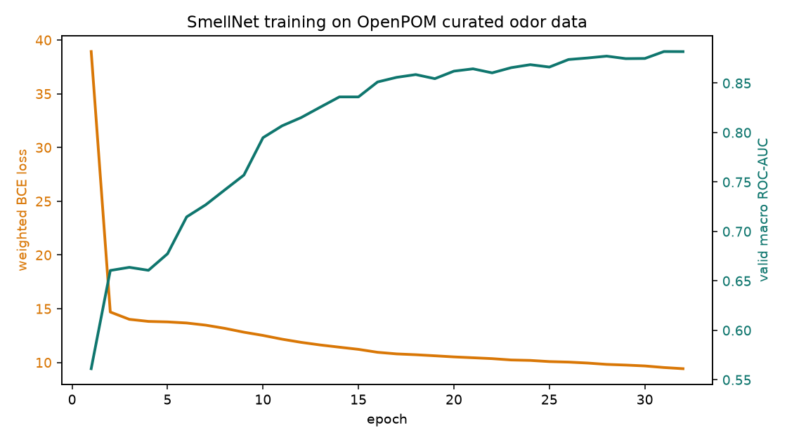

# What Is That Smell? — an AI that can smell

An end-to-end olfaction project built on [OpenPOM](https://github.com/BioMachineLearning/openpom)'s
architecture and curated odor data.

| Project | What it does |
| --- | --- |
| **[`smellnet/`](smellnet/README.md)** | Trains a graph neural network to map molecular structure → **138 human odor descriptors**, then exports a model, metrics and a 256-d odor embedding library. |
| **[`what_is_that_smell/`](what_is_that_smell/README.md)** | A **simulated 16-channel electronic nose**. Pick a vial or paste a SMILES, watch the MOS array respond, and let the model decode the smell. |

The provided OpenPOM repo lives untouched at
[`openpom-main/openpom-main/`](openpom-main/openpom-main/README.md); it supplies the model
definition, the featurizer reference and the curated datasets. Its bundled ensemble checkpoints are
Git LFS pointer files, so this project trains its own model from those datasets.



## Quick start

Requires Python 3.10+ (tested on 3.13). From this directory:

```bash
python -m venv .venv
source .venv/bin/activate            # Windows: .venv\Scripts\activate
pip install -r requirements.txt

# train the nose (≈30 min on 8 CPU cores; a checkpoint already exists)
python -m smellnet.train

# run the instrument
python run_app.py
# → http://127.0.0.1:8017
```

The training command is resumable in the sense that it always starts from the data and keeps the
best-validation checkpoint; it does not resume an interrupted run. Use `--max-rows 512 --epochs 1`
for a quick end-to-end smoke test.

## The model

MPNN-POM is OpenPOM's implementation of the Principal Odor Map. This project ports it to plain
PyTorch (no DGL or DeepChem) while preserving the published layer math:

```
molecule graph (134-d atoms, 6-d bonds, both directions)
  → Linear + ReLU
  → 5 × [NNConv residual message passing → ReLU → GRU]
  → atom/bond folding → Set2Set readout (6 steps, 3 iterations) → 400-d
  → FFN 400→392→392→256
  → 138 sigmoid odor probabilities + 256-d POM embedding
```

Training details:

- **Data:** `curated_GS_LF_merged_4983.csv` (4,983 molecules, 138 notes, 0 parse failures).
- **Split:** 80/10/10 multilabel iterative stratification (Sechidis) via
  `iterative-stratification`; every note appears in every split. Exact sizes are in
  [`smellnet/artifacts/metrics.json`](smellnet/artifacts/metrics.json).
- **Loss:** weighted binary cross-entropy over the 138 notes; rare notes get `log1p(max/count)`
  weight (normalized), with an OpenPOM-style weighting option.
- **Optimizer:** Adam, StepLR halving every 15 epochs, early stopping on validation macro ROC-AUC.
- **Hardware:** CPU. The run is reproducible with `--seed 42`.

Held-out performance of the checked-in run:

| Metric | Value |
| --- | --- |
| Best epoch | 31 / 32 |
| Validation macro ROC-AUC | 0.882 |
| Test macro ROC-AUC | 0.880 |
| Test micro ROC-AUC | 0.923 |
| Parameters | 2,088,027 |

These numbers are for a **single model on one split**, not the paper's 10-model × 5-fold ensemble
(0.8872), so they are not directly comparable. Per-note scores and the full report are in
[`metrics.json`](smellnet/artifacts/metrics.json).

Try the model directly:

```bash
python -m smellnet.predict "COc1cc(C=O)ccc1O" --top 8
# vanilla 0.88 · sweet 0.77 · phenolic 0.57 · spicy 0.46 · floral 0.31 ...
```

## The simulated electronic nose

The app turns a molecule into a scent experience:

1. **Scent rack** — 33 real aroma compounds, or any SMILES you type.
2. **Chamber** — RDKit structure drawing, conditions (1–500 ppm, 10–95% RH, 15–45 °C) and a
   live 16-channel metal-oxide array.
3. **Physics-inspired traces** — each virtual film has a selectivity profile over molecular
   descriptors and the model's odor families. Response follows a Langmuir concentration curve and a
   first-order rise/decay with drift, noise, humidity and temperature cross-talk. A sniff runs for
   9.2 s at 12.5 Hz.
4. **Decoded result** — top odor notes, a six-axis family fingerprint, nearest neighbours in POM
   embedding space, and the closest vial on the rack.
5. **Identity check** — if the molecule is in the curated reference set, the app marks it and shows
   whether it was a train/valid/test molecule.

Everything runs locally; there is no external model API, no real sensor, and no telemetry.

## Layout

```
.
├── smellnet/                     # model project
│   ├── featurizer.py             # OpenPOM 134-d atom / 6-d bond graph featurizer
│   ├── model.py                  # MPNN-POM port (NNConv + GRU + Set2Set + FFN)
│   ├── data.py                   # dataset loading, stratification, metrics
│   ├── descriptors.py            # RDKit descriptors used by the sensor simulation
│   ├── train.py                  # training/evaluation CLI and artifact export
│   ├── predict.py                # single-molecule CLI
│   └── artifacts/                # model.pt, metrics.json, odor_space.npz, curves
├── what_is_that_smell/           # simulated e-nose app
│   ├── server.py                 # FastAPI backend
│   ├── sensors.py                # 16-channel MOS response simulation
│   ├── families.py               # odor-note → family aggregation
│   ├── library.py                # 33 sample vials
│   └── static/                   # instrument console UI
├── openpom-main/openpom-main/    # provided OpenPOM repository + curated datasets
├── run_app.py                    # convenience entrypoint for the app
└── requirements.txt
```

## Data and provenance

The training CSV is the merged GoodScents + Leffingwell curated set from OpenPOM. Individual source
datasets are included too; `python -m smellnet.train --data .../curated_goodcents.csv` works.
The Leffingwell source lacks the `cortex` note; the loader fills absent notes with zeros so the
138-output head stays consistent.

Model architecture and data cleaning are OpenPOM's work:
**Aryan Amit Barsainyan, Ritesh Kumar, Pinaki Saha, Michael Schmuker.**
Paper: Lee et al., *A Principal Odor Map Unifies Diverse Tasks in Human Olfactory Perception*,
Science 381, 999–1006 (2023), [doi:10.1126/science.ade4401](https://doi.org/10.1126/science.ade4401).

## Honest limits

- **The nose is a simulation.** Sensor responses are synthetic and physically inspired, not
  measurements. The UI says so in the footer.
- **Odor labels are human descriptors**, often multi-label and culturally specific. The model
  predicts independent note probabilities; a high score is not a chemical identity.
- **Single model, single split.** See the metrics caveats above. Rare notes have few test examples
  and their individual AUCs are noisy.
- **The port is faithful in layers, not bit-exact in training details.** It uses BCE-with-logits
  instead of OpenPOM's `[1-p, p]` cross-entropy quirk, and no ensemble. See
  [`smellnet/README.md`](smellnet/README.md) for the two deviations.
- The reference checkpoints in the provided repo are LFS pointers; they are not used.
